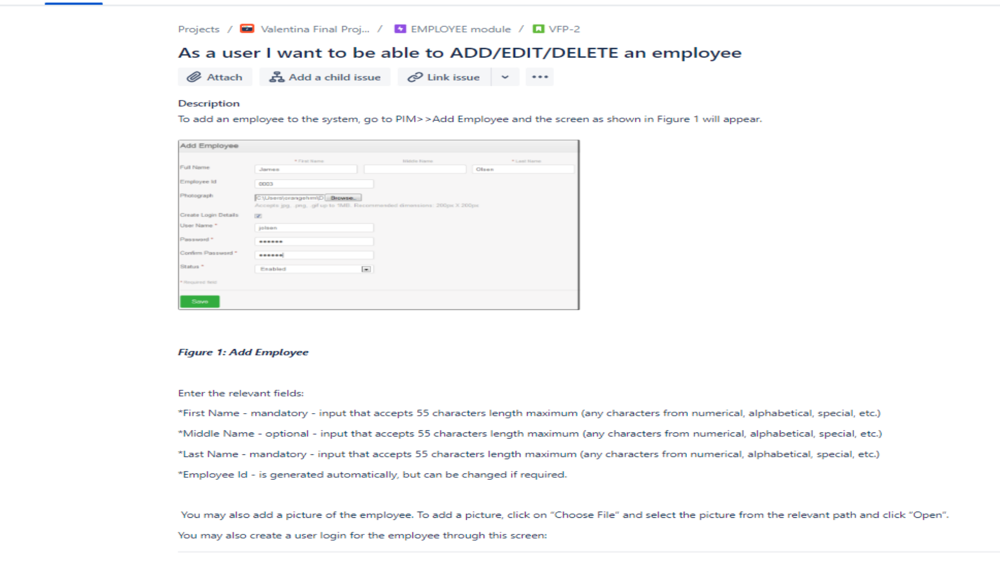
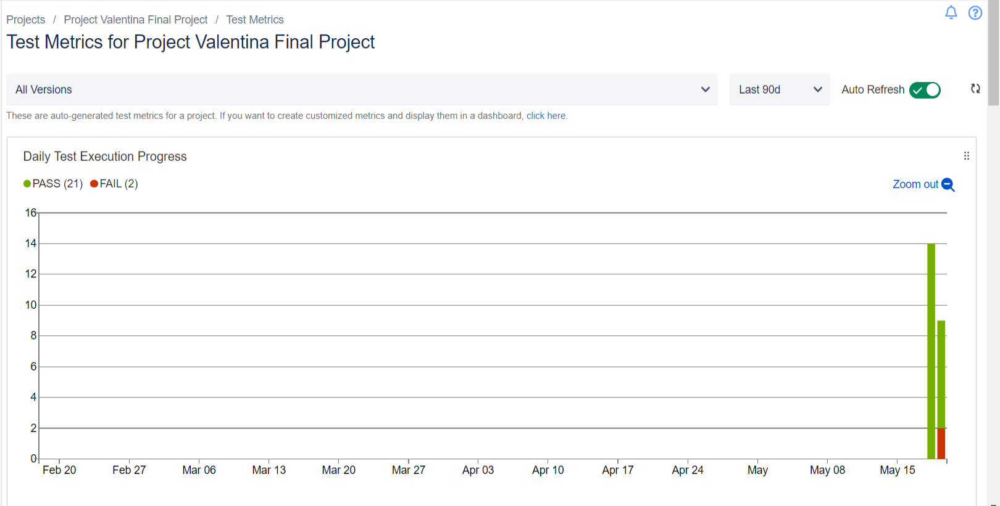
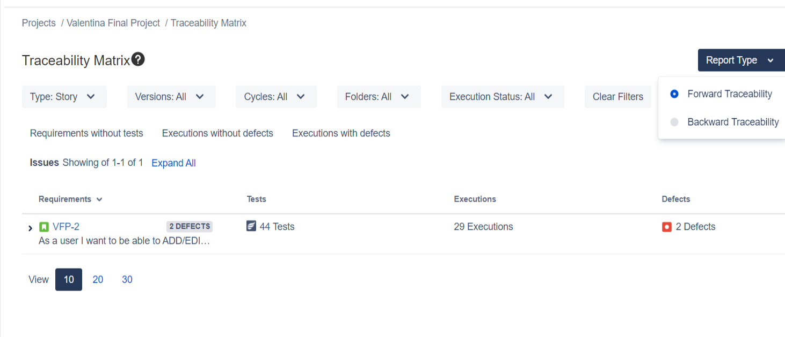
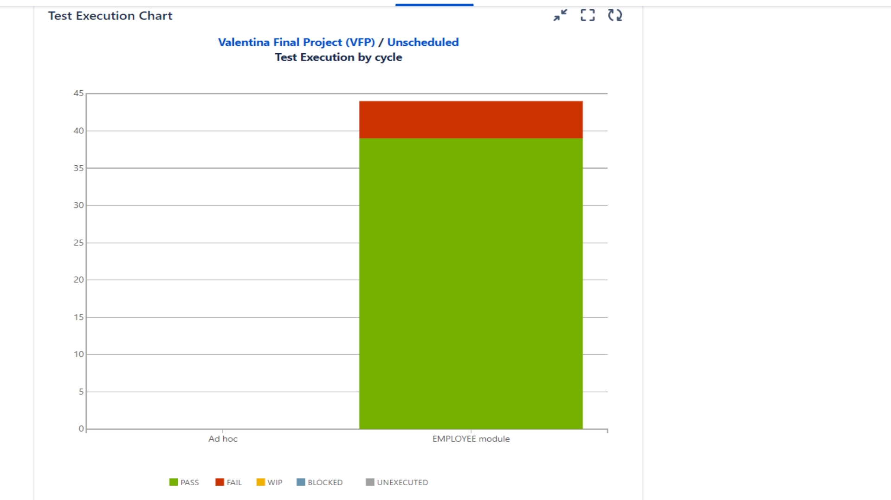

<h1 align="center">Final Project – ITF Manual Testing Course</h1>

<p align="center">Testing the Employee Module of the OrangeHRM Application</p>

<p align="center">
<b>Download PDF Documentation:</b><br>
<a href="Final_Project_Manual_Testing_Valentina_Hatos.pdf"><b>[ English Version PDF ]</b></a><br>
<a href="Proyecto_Final_Testing_Manual_Valentina_Hatos.pdf"><b>[ Versión en Español PDF ]</b></a>
</p>

---

## Index

- [1. Introduction](#1-introduction)
  - [1.1 Application under test](#11-application-under-test)
  - [1.2 Tools used](#12-tools-used)
- [2. Functional Specifications](#2-functional-specifications)
- [3. Test Planning](#3-test-planning)
  - [3.1 Roles and persons assigned](#31-roles-and-persons-assigned)
  - [3.2 Entry criteria](#32-entry-criteria)
  - [3.3 Exit criteria](#33-exit-criteria)
  - [3.4 Test scope](#34-test-scope)
  - [3.5 Risks](#35-risks)
  - [3.6 Evaluating the entry criteria](#36-evaluating-the-entry-criteria)
- [4. Test Monitoring and Control](#4-test-monitoring-and-control)
- [5. Test Analysis](#5-test-analysis)
- [6. Test Design](#6-test-design)
  - [6.1 Test design techniques](#61-test-design-techniques)
  - [6.2 Checklist](#62-checklist)
  - [6.3 Test cases](#63-test-cases)
  - [6.4 API test checklist](#64-api-test-checklist)
- [7. Test Implementation](#7-test-implementation)
- [8. Test Execution](#8-test-execution)
  - [8.1 Functional test execution](#81-functional-test-execution)
  - [8.2 Bugs reported](#82-bugs-reported)
  - [8.3 API testing](#83-api-testing)
- [9. Test Completion](#9-test-completion)
  - [9.1 Exit criteria evaluation](#91-exit-criteria-evaluation)
  - [9.2 Conclusion](#92-conclusion)
- [10. SQL Section](#10-sql-section)
  - [10.1 Creating the database and the tables](#101-creating-the-database-and-the-tables)
  - [10.2 Inserting data](#102-inserting-data)
  - [10.3 Queries](#103-queries)
- [11. Final Thoughts](#11-final-thoughts)
- [12. Project Files](#12-project-files)

---

## 1. Introduction

This is my final project for the ITF Manual Testing course. The goal of the project was to apply the knowledge gained during the course on a live application.

I tested the Employee module of OrangeHRM, an open-source human resources application. The module allows a user to add, edit and delete employees.

The project has two sections:

- **Testing section** – I followed the main phases of the testing process: planning, monitoring and control, analysis, design, implementation, execution and completion.
- **SQL section** – I created a small database and wrote queries to select, update and delete data.

### 1.1 Application under test

| Item | Details |
|---|---|
| Application | OrangeHRM (open-source demo) |
| URL | https://opensource-demo.orangehrmlive.com/ |
| API documentation | https://orangehrm.github.io/orangehrm-api-doc/ |
| Test account | Username: Admin \| Password: admin123 |
| Module tested | Employee (PIM >> Add Employee, Personal Details, Employee List) |

### 1.2 Tools used

| Tool | How I used it |
|---|---|
| JIRA | I created the project, the user story, the test issues and the bug reports. |
| Zephyr Squad | I wrote the test steps, created the test cycle, executed the tests and generated the reports. |
| Postman | I created a collection of requests and tested the API. |
| MySQL Workbench | I created the database and the tables, inserted data and ran the queries. |
| Better PDF Exporter for Jira | I exported the test cases, the executions and the bugs to PDF files. |

---

## 2. Functional Specifications

The functional specifications were written as a user story in JIRA. The story is VFP-2: *"As a user I want to be able to ADD/EDIT/DELETE an employee"*. It belongs to the epic VFP-1 (EMPLOYEE module).

Full specifications: [Final_Project_Functional_Specifications.pdf](Final_Project_Functional_Specifications.pdf)



The story describes three main actions:

- **Add an employee** – from PIM >> Add Employee. The user enters the name, the Employee Id and can upload a photo. The user can also create login details for the employee.
- **Edit an employee** – from the Personal Details screen. The user clicks Edit, changes the fields and clicks Save.
- **Delete an employee** – from PIM >> Employee List. The user selects one or more employees and clicks Delete.

The main rules for the fields are listed below.

| Field | Section | Rule |
|---|---|---|
| First Name | Add / Edit | Mandatory, maximum 55 characters (any type) |
| Middle Name | Add / Edit | Optional, maximum 55 characters (any type) |
| Last Name | Add / Edit | Mandatory, maximum 55 characters (any type) |
| Employee Id | Add / Edit | Generated automatically, can be changed |
| Photograph | Add | .jpg, .png or .gif, maximum 1 MB |
| User Name | Login details | Mandatory |
| Password | Login details | Mandatory, strong combination recommended |
| Confirm Password | Login details | Mandatory |
| Status | Login details | Mandatory dropdown: Enabled or Disabled |
| Nationality | Edit | Selected from a predefined list |
| Date of Birth | Edit | Optional, datepicker, format yyyy-mm-dd |
| Marital Status | Edit | Optional dropdown: Single, Married or Other |
| Smoker | Edit | Checkbox |
| Gender | Edit | Radio buttons: Male or Female |
| License Expiry Date | Edit | Optional, datepicker, format yyyy-mm-dd |
| Nick Name, Other Id, Driver's License Number, Military Service | Edit | Optional text fields |

---

## 3. Test Planning

In this phase, I created the test plan. The plan describes what will be tested, how, by whom, and which risks exist.

### 3.1 Roles and persons assigned

| Role | Person |
|---|---|
| Project Manager | Maria Macavei |
| Product Owner | David Dafinescu |
| Software Developer | Adrian Adagiu |
| QA Engineer | Valentina Hatos |

### 3.2 Entry criteria

Testing could start only when these conditions were met:

- The functional specifications are defined.
- The roles needed for the project are assigned.
- The initial project risks were identified and mitigated.

### 3.3 Exit criteria

Testing could be considered complete when these conditions were met:

- The number of unresolved bugs is insignificant, or they have low priority.
- All tests have been executed.
- All resolved bugs have been re-tested and approved by the QA team.
- The deadline was reached.
- No major risk remains un-mitigated.
- Exploratory regression testing is performed on the PIM module, which includes the Employee section.

### 3.4 Test scope

**In scope:** all the features of the Employee module defined in the specifications. I planned functional testing, GUI testing and API testing.

**Out of scope:** performance testing, integration of the Employee module with other modules, and compatibility testing on multiple browsers.

### 3.5 Risks

| Type | Risk |
|---|---|
| Project risks | Lack of experience of the QA team; the short trial period of Zephyr Squad; the test environment might be unavailable. |
| Product risks | The validation rules on the fields might be too restrictive for the end user. |

### 3.6 Evaluating the entry criteria

I checked the entry criteria before starting. All of them were met, so the testing process continued.

---

## 4. Test Monitoring and Control

During testing, I generated periodic reports in Zephyr. The reports showed the current status of the testing process. If a major problem appeared, control measures could be taken.

On 19 May 2022, more than 50% of the test cases had been executed. At that moment, I generated the status report below. The Daily Test Execution Progress chart showed 21 passed and 2 failed executions.



I also checked the Traceability Matrix in Zephyr. It showed that the 44 tests were linked to story VFP-2 and that 2 defects had been reported at that point.



The testing process was on track, so I continued with the remaining test cases.

---

## 5. Test Analysis

In this phase, I analysed the specifications to find out what needs to be tested. I identified the following test conditions:

- Enter data only in the mandatory fields and check that the employee is created/updated.
- Enter data in all available fields and check that the employee is created/updated.
- Leave the mandatory fields empty and check that the employee cannot be created/updated.
- Check that an employee can be deleted.
- View the employee details and check that they are correct.
- View all employees in a list.
- Check all the validation rules for the fields.

---

## 6. Test Design

### 6.1 Test design techniques

Based on the specifications, I used three test design techniques:

- **Equivalence partitioning** – I split the input values into valid and invalid groups. For example, I tested images up to 1 MB (valid) and images larger than 1 MB (invalid).
- **Boundary value analysis** – I tested the values at the limits. For example, the name fields were tested with 55 characters (the maximum) and 56 characters (one above the maximum).
- **Use case testing** – I tested the complete flows a user follows: adding, editing and deleting an employee.

### 6.2 Checklist

First, I created a checklist with 20 items. The checklist covers the GUI, the fields of each section, the mandatory fields, the dropdown and radio button options, and the behaviour of the Save and Delete buttons. Some examples:

- Verify that the Add Employee section contains all the fields from the specifications.
- Verify that all the mandatory fields are marked with *.
- Verify that the Status dropdown contains only 2 options: Enabled and Disabled.
- Verify that Male and Female are the only options for the Gender field.
- Verify that navigation between fields works using Tab.

Full checklist: [Checklist.pdf](Checklist.pdf)

### 6.3 Test cases

Next, I wrote 44 test cases. I created them in JIRA as Test issues (VFP-5 to VFP-48) and added the steps in Zephyr Squad. Each test case contains:

- a title that starts with "Verify that…";
- the test steps;
- the test data, where needed;
- the expected result for each step;
- a priority (Highest, High, Medium, Low or Lowest);
- links to the epic VFP-1 and the story VFP-2.

I assigned the priorities based on the importance of each function. The main flows (add, edit, delete, mandatory fields) received the highest priority. Format checks and character limits received a lower priority.

Below is an example of a test case with its steps.

**VFP-5: Verify the mandatory fields in the Add Employee section** (Priority: Highest)

| # | Test step | Expected result |
|---|---|---|
| 1 | Log into the application | User is logged into the application |
| 2 | Go to PIM >> Add Employee | Add Employee section is opened |
| 3 | Fill in all the mandatory fields, except First Name, and click Save | The employee isn't saved, First Name field is required |
| 4 | Fill in all the mandatory fields, except Last Name, and click Save | The employee isn't saved, Last Name field is required |
| 5 | Click on the Create Login Details box | Create Login Details section is opened |
| 6 | Fill in all the mandatory fields, except User Name, and click Save | The employee isn't saved, User Name field is required |
| 7 | Fill in all the mandatory fields, except Password, and click Save | The employee isn't saved, Password field is required |
| 8 | Fill in all the mandatory fields, except Confirm Password, and click Save | The employee isn't saved, Confirm Password field is required |
| 9 | Fill in all the mandatory fields, except Status, and click Save | The employee isn't saved, Status field is required |

List of test cases with priorities: [Test_cases.pdf](Test_cases.pdf)<br>
Complete test cases with all their steps: [Employee_test_cases_with_steps.pdf](Employee_test_cases_with_steps.pdf)

### 6.4 API test checklist

For the Employee API, I created a separate checklist. It covers three methods: GET, POST and PUT. Some examples are shown below.

| Method | Examples of checks |
|---|---|
| GET /api/v1/employee/:id | An array of employees is returned when they exist; an unauthorized error is returned for an invalid token; a random employee id returns an error. |
| POST /api/v1/employee/:id | An employee is saved with only the mandatory parameters; the employee is not saved without the "firstName" or "lastName" parameter; an error is returned for an invalid data type. |
| PUT /api/v1/employee/:id | An employee is updated with all accepted parameters; an error is returned for a duplicate name; an unauthorized error is returned for an invalid token. |

Complete API checklist: [API_test_checklist.csv](API_test_checklist.csv)

---

## 7. Test Implementation

Before the execution phase, I prepared the following elements:

- I checked that the test environment was up and running: https://opensource-demo.orangehrmlive.com/
- I verified the access to the environment with the account Admin / admin123.
- I created a test cycle in Zephyr, named "EMPLOYEE module".
- I added all 44 test cases to the test cycle.
- I created a Postman collection with the API requests.
- I generated an authorization token for accessing the API.

---

## 8. Test Execution

### 8.1 Functional test execution

I executed the test cases in the "EMPLOYEE module" test cycle between 18 and 21 May 2022. For each test, I followed the steps and compared the actual result with the expected result. I marked each step as PASS or FAIL. When a test failed, I created a bug and linked it to the execution.

All 44 test cases were executed. 39 tests passed and 5 tests failed.

Below are two examples of executed tests: one that passed and one that failed.

| ID | Test case | Priority | Result |
|---|---|---|---|
| VFP-47 | Verify that an employee can be deleted | Highest | ✅ PASS |
| VFP-37 | Verify that Date of Birth input field doesn't accept dates greater than the current date | High | ❌ FAIL |

**VFP-47 (PASS):** I selected an employee in the Employee List and clicked Delete. The employee was removed from the list, as expected.

**VFP-37 (FAIL):** I entered a future date in the Date of Birth field. The field accepted the date and no error was shown. I reported bug VFP-49 for this test.

Complete execution results for all 44 tests: [Employee_cycle_summary_execution.pdf](Employee_cycle_summary_execution.pdf)

### 8.2 Bugs reported

For each failed test, I created a bug in JIRA. In total, I reported 5 bugs: 2 with High priority and 3 with Low priority.

| Bug | Title | Priority | Found by | Status |
|---|---|---|---|---|
| VFP-49 | Date of Birth field accepts a date greater than the current date | High | VFP-37 | To Do |
| VFP-50 | License Expiry Date field accepts a date smaller than the current date | High | VFP-41 | To Do |
| VFP-51 | Photograph upload section accepts .jpg/.png/.gif image larger than 1 MB | Low | VFP-19 | To Do |
| VFP-52 | First Name, Middle Name and Last Name input fields don't accept 55 characters, in Add Employee module | Low | VFP-14 | To Do |
| VFP-53 | First Name, Middle Name and Last Name input fields don't accept 55 characters, in Edit Personal Details module | Low | VFP-16 | To Do |

Each bug report contains the steps to reproduce, the expected result, the actual result, the priority and links to the related test, epic and story. Below is an example.

| Field | VFP-49 |
|---|---|
| Title | Date of Birth field accepts a date greater than the current date |
| Type / Priority | Bug / High |
| Reporter / Assignee | Valentina Hatos |
| Steps to reproduce | 1. Log into the application. 2. Go to PIM >> Employee List. 3. Select an employee and click Edit. 4. Fill in the Date of Birth field with a date greater than the current date. |
| Expected result | The field isn't completed, an error is shown. |
| Actual result | The field is completed. |
| Links | VFP-37 (test), VFP-1 (epic), VFP-2 (story) |

Complete bug reports: [Employee_created_bugs.pdf](Employee_created_bugs.pdf)

For bugs VFP-52 and VFP-53, I found that the name fields don't accept more than 30 characters, while the specifications require 55 characters.

### 8.3 API testing

I tested the API in Postman, based on the API checklist. I created a collection called "Orange HRM API Collection". The collection uses two variables: `{{base_url}}` for the application address and `{{auth_token}}` for the authorization.

Postman collection: [Orange HRM API Collection.postman_collection.json](Orange%20HRM%20API%20Collection.postman_collection.json)

**Getting the access token**

First, I sent a POST request to `/index.php/oauth/issueToken`. The body contains the client id, the client secret and the grant type "client_credentials". I added a test script to this request. The script verifies that the status code is 200. Then it saves the token from the response into the `auth_token` environment variable. In this way, the other requests use the token automatically.

```javascript
pm.test("Status code is 200", function () {
    pm.response.to.have.status(200);
});
var res_body = pm.response.json();
pm.environment.set("auth_token", `Bearer ${res_body.access_token}`);
```

**Employee requests**

For the Employee API, I configured three requests:

- **GET Employee** – returns the details of an employee by id.
- **Save Employee (POST)** – saves an employee with the parameters firstName and lastName.
- **Update Employee (PUT)** – updates the data of an employee, for example the gender.

For each request, I changed the parameters and the token according to the checks from the API checklist. Then I verified the status code and the response body.

**Other requests in the collection**

The collection also contains requests for the Time module: Customers, Projects and Activities. For each of them, I configured GET, POST, PUT and DELETE requests. For DELETE Customers, I added a test script. The script verifies that the status code is 404 and that the response contains the message "Customer Not Found".

```javascript
pm.test("Status code is 404", function () {
    pm.response.to.have.status(404);
});
pm.test("Verify the response body is correct", function () {
    var jsonData = pm.response.json();
    pm.expect(jsonData.error.status).to.eql("404");
    pm.expect(jsonData.error.text).to.eql("Customer Not Found");
});
```

---

## 9. Test Completion

In the last phase, I collected the final results and generated the final reports.

- A total of 44 test cases were planned for execution, and all of them were executed.
- 39 tests passed and 5 tests failed.
- A total of 5 bugs were reported: 2 with High priority and 3 with Low priority.
- I generated the traceability matrix. It links story VFP-2 to each test, its execution and the related bugs.
- I generated the test execution chart for the "EMPLOYEE module" test cycle.

Traceability matrix: [Traceability_Matrix.xlsx](Traceability_Matrix.xlsx)



### 9.1 Exit criteria evaluation

| Exit criterion | Status |
|---|---|
| All tests have been executed | Met (44 of 44) |
| The deadline was reached | Met |
| Unresolved bugs are insignificant or have low priority | Not yet met – VFP-49 and VFP-50 have High priority |
| All resolved bugs have been re-tested | Pending – the bugs are not fixed yet |
| Exploratory regression on the PIM module | Planned after the fixes |

### 9.2 Conclusion

The main functions of the Employee module work as expected. Employees can be added, edited and deleted. The mandatory fields, the login details, the dropdowns and the employee list work correctly.

Two High priority bugs are still open. They are related to the date validation for Date of Birth (VFP-49) and License Expiry Date (VFP-50).

**Recommendation:** the testing team recommends Go Live after VFP-49 and VFP-50 are fixed and re-tested. The three Low priority bugs (VFP-51, VFP-52, VFP-53) can be fixed in a later release. After the fixes, a full regression test is needed on the PIM module.

---

## 10. SQL Section

In the second part of the project, I used MySQL Workbench. I created a database named "orangehrm" with two tables: departments and employees.

Complete SQL script: [orangehrm database.sql](orangehrm%20database.sql)

### 10.1 Creating the database and the tables

```sql
create database orangehrm;
use orangehrm;
```

The departments table stores the code, the name and the manager of each department. The `department_code` column is the primary key.

```sql
create table departments(
department_code int primary key not null,
department_name varchar(55) not null,
department_manager varchar(55) not null
);
```

The employees table stores the employee data. The `employee_id` column is the primary key and increases automatically. The `department` column is a foreign key. It references the `department_code` column from the departments table.

```sql
create table employees(
employee_id int primary key auto_increment,
first_name varchar(55) not null,
last_name varchar(55) not null,
date_of_birth date,
job_title varchar(55),
department int not null,
constraint fk_departments_department_code foreign key (department)
  references departments(department_code)
);
```

I set the name columns to a maximum of 55 characters, the same limit as in the specifications.

### 10.2 Inserting data

I inserted 3 departments and 11 employees.

| Code | Department | Manager |
|---|---|---|
| 11 | Human Resources | Janet Smith |
| 12 | Accounting | Mary Adams |
| 13 | IT | Michael Collins |

```sql
insert into departments (department_code, department_name, department_manager) values
(11, "Human Resources", "Janet Smith"), (12, "Accounting", "Mary Adams"),
(13, "IT", "Michael Collins");

insert into employees (first_name, last_name, date_of_birth, job_title, department) values
("Katie", "Jones", "1983-08-20", "Financial administrator", 12),
("David", "Moore", "1976-07-19", "HR administrator", 11),
... (11 employees in total)
```

Then I checked the content of both tables with `SELECT *` queries.

### 10.3 Queries

I wrote 15 queries. They cover filtering, sorting, grouping, joins, subqueries, and updating and deleting data. Four examples are shown below.

**Task 2:** Select all the data of employees whose last name is "Carter".

```sql
select * from employees where last_name = 'Carter';
```

I used a WHERE condition to filter the rows by last name. The query returns two employees.

**Task 5:** Select all the data of employees, including each employee's department data.

```sql
select * from employees e inner join departments d
on e.department = d.department_code;
```

I joined the two tables using the foreign key. I used the aliases "e" and "d" to keep the query short.

**Task 9:** Select the names of departments with more than three employees.

```sql
select d.department_name from departments d
where 3 < (select count(*) from employees where department = d.department_code);
```

I used a subquery. For each department, the subquery counts its employees. Only departments with more than three employees are returned.

**Task 14:** Reassign all employees from Accounting (code 12) to Human Resources (code 11).

```sql
update employees set department = 11 where department = 12;
```

I used an UPDATE statement with a WHERE condition. Only the Accounting employees were moved.

All 15 tasks and their queries: [orangehrm database.sql](orangehrm%20database.sql)

---

## 11. Final Thoughts

This project helped me apply the full testing process on a real application. I planned the testing, designed and executed the test cases, reported bugs and generated reports in JIRA and Zephyr Squad. I also practised API testing in Postman and wrote SQL queries in MySQL Workbench.

---

## 12. Project Files

| File | Description |
|---|---|
| [Final_Project_Manual_Testing_Valentina_Hatos.pdf](Final_Project_Manual_Testing_Valentina_Hatos.pdf) | Full project documentation (English) |
| [Proyecto_Final_Testing_Manual_Valentina_Hatos.pdf](Proyecto_Final_Testing_Manual_Valentina_Hatos.pdf) | Full project documentation (Spanish) |
| [Final_Project_Functional_Specifications.pdf](Final_Project_Functional_Specifications.pdf) | Functional specifications of the Employee module |
| [Checklist.pdf](Checklist.pdf) | Checklist for Add/Edit/Delete Employee |
| [Test_cases.pdf](Test_cases.pdf) | List of test cases with priorities |
| [Employee_test_cases_with_steps.pdf](Employee_test_cases_with_steps.pdf) | Test cases with steps, exported from Zephyr Squad |
| [Employee_cycle_summary_execution.pdf](Employee_cycle_summary_execution.pdf) | Execution results of the "EMPLOYEE module" test cycle |
| [Employee_created_bugs.pdf](Employee_created_bugs.pdf) | Bug reports |
| [Traceability_Matrix.xlsx](Traceability_Matrix.xlsx) | Traceability matrix |
| [API_test_checklist.csv](API_test_checklist.csv) | API test checklist |
| [Orange HRM API Collection.postman_collection.json](Orange%20HRM%20API%20Collection.postman_collection.json) | Postman collection |
| [orangehrm database.sql](orangehrm%20database.sql) | SQL script with the database, tables and queries |
