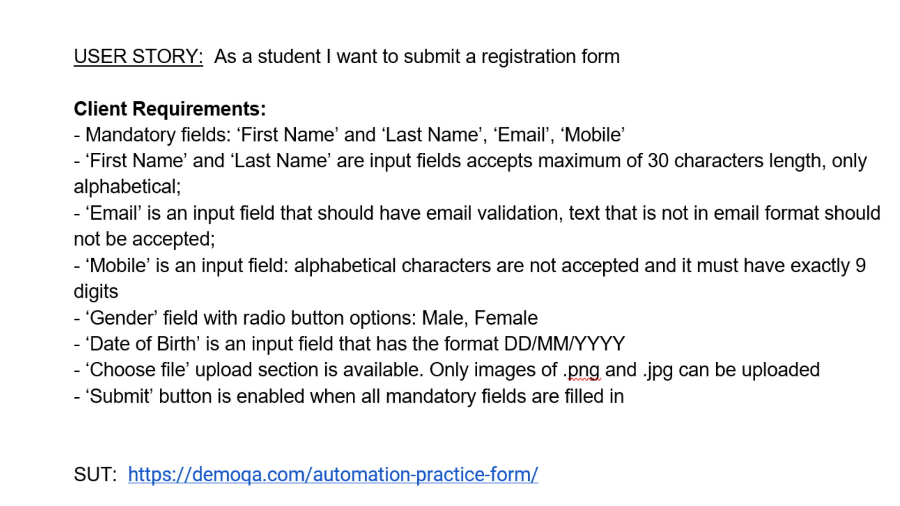

<h1 align="center">Student Registration Form Testing</h1>

Test Design, Execution and Bug Reporting

<b>Download PDF Documentation:</b> 
<a href="Student_Registration_Form_Testing_Valentina_Hatos.pdf"><b>[ English Version PDF ]</b></a> 
<a href="Pruebas_Formulario_Registro_Estudiantes_Valentina_Hatos.pdf"><b>[ Versión en Español PDF ]</b></a>

---

## Index

- [1. Introduction](#1-introduction)
- [2. Requirements](#2-requirements)
- [3. Test Design](#3-test-design)
  - [3.1 Test cases by area](#31-test-cases-by-area)
  - [3.2 Example test case](#32-example-test-case)
- [4. Test Execution](#4-test-execution)
  - [4.1 Results](#41-results)
  - [4.2 Examples](#42-examples)
- [5. Bugs Reported](#5-bugs-reported)
  - [5.1 Bug summary](#51-bug-summary)
  - [5.2 Example bug report](#52-example-bug-report)
- [6. Conclusion](#6-conclusion)
- [Project Files](#project-files)

---

## 1. Introduction

This project is a testing exercise from the ITF Manual Testing course. I tested the Student Registration Form from the DemoQA website: https://demoqa.com/automation-practice-form/

I started from the client requirements. I wrote 50 test cases in JIRA and Zephyr Squad and executed them. For each failed test, I reported a bug in JIRA.

| Item | Details |
|---|---|
| Student | Valentina Hatos |
| Role | QA Tester |
| Application | DemoQA – Practice Form |
| Module tested | Student Registration Form |
| Tools | JIRA, Zephyr Squad, Better PDF Exporter for Jira |
| Date | March 2022 |

---

## 2. Requirements

The requirements were written as a user story: "As a student I want to submit a registration form".

| Field | Requirement |
|---|---|
| First Name, Last Name | Mandatory, maximum 30 characters, only alphabetical |
| Email | Mandatory, must be in email format |
| Mobile | Mandatory, only digits, exactly 9 digits |
| Gender | Radio buttons: Male, Female |
| Date of Birth | Format DD/MM/YYYY |
| Choose File | Only .png and .jpg images |
| Submit | Enabled when all mandatory fields are filled in |

---

## 3. Test Design

### 3.1 Test cases by area

I created 50 test cases in JIRA (VALI-34 to VALI-90) and linked them to the user story VALI-33. I added the steps and the expected results in Zephyr Squad. All the test cases have Medium priority.

To design the test cases, I used boundary values and valid and invalid inputs. For example, I tested the name fields with 30 and 31 characters, and the Mobile field with 8, 9 and 10 digits.

| Area | Tests | What I verified |
|---|---|---|
| Layout and GUI | 7 | Position of the form, alignment, list of fields, Tab and Enter navigation, mandatory field marks |
| Mandatory fields and submitting | 8 | Each mandatory field, submitting with and without optional fields |
| First Name and Last Name | 4 | Uppercase and lowercase, 30 and 31 characters, only letters |
| Email | 5 | Email format, inline validation, Yahoo and Gmail addresses |
| Mobile | 4 | 8, 9 and 10 digits, only digits |
| Gender | 4 | Male and Female options, one option at a time |
| Date of Birth | 4 | Format, future dates, invalid day and month |
| Choose File | 6 | .png and .jpg images, other files, more images, delete and view |
| Submit button | 5 | Enabled and disabled state of the button |
| Saved data | 3 | All fields completed, form saved in a list, data saved correctly |

### 3.2 Example test case

**VALI-41: Verify that First Name is mandatory field**

| # | Test step | Expected result |
|---|---|---|
| 1 | Log into the application | User is logged into the application |
| 2 | Go to the Forms > Practice Form | Student Registration Form is opened |
| 3 | Fill in all the mandatory fields, except First Name field | First Name field is empty, all other mandatory fields are completed |
| 4 | Press Enter to submit the form | The form isn't submitted, the mandatory First Name field needs to be completed |

---

## 4. Test Execution

### 4.1 Results

I executed all 50 test cases in the test cycle "Run test for Submit a registration form", between 12 and 14 March 2022. For each test, I marked every step as PASS or FAIL. When a step failed, I reported a bug and linked it to the execution.

| Result | Number of tests |
|---|---|
| ✅ PASS | 24 |
| ❌ FAIL | 26 |
| Total | 50 |

| Area | PASS | FAIL |
|---|---|---|
| Layout and GUI | 4 | 3 |
| Mandatory fields and submitting | 5 | 3 |
| First Name and Last Name | 2 | 2 |
| Email | 4 | 1 |
| Mobile | 2 | 2 |
| Gender | 3 | 1 |
| Date of Birth | 0 | 4 |
| Choose File | 3 | 3 |
| Submit button | 0 | 5 |
| Saved data | 1 | 2 |

### 4.2 Examples

**VALI-41 (PASS):** I left the First Name field empty and pressed Enter. The form wasn't submitted, as expected.

**VALI-56 (FAIL):** I filled in the Mobile field with 9 digits and pressed Enter. The form wasn't submitted and an error was shown. According to the requirements, 9 digits must be accepted. I reported bug VALI-94.

📄 Complete test cases with steps and execution results: [Student_Registration_Form_TEST_CASES_EXECUTION.pdf](Student_Registration_Form_TEST_CASES_EXECUTION.pdf)

---

## 5. Bugs Reported

### 5.1 Bug summary

I reported 19 bugs. All of them have Medium priority and the status "Selected for Development".

| Bug | Title |
|---|---|
| VALI-84 | The lower part of the form is not accessible on the web page |
| VALI-85 | Mandatory fields aren't marked * against the field |
| VALI-86 | Email field isn't a mandatory field |
| VALI-87 | Optional Subjects field doesn't keep the text written after moving to another field |
| VALI-88 | Submit button isn't working |
| VALI-91 | First Name and Last Name input fields accept more than 30 alphabetical characters |
| VALI-92 | First Name and Last Name input fields accept characters other than letters |
| VALI-93 | Email address isn't colored |
| VALI-94 | Mobile input field doesn't accept 9 digits |
| VALI-95 | Mobile input field accepts 10 digits |
| VALI-96 | Male and Female aren't the only radio button options for Gender field |
| VALI-97 | Date of Birth format is incorrectly implemented |
| VALI-98 | A Date of Birth greater than the current date is accepted |
| VALI-99 | Date of Birth input field accepts a date with an invalid day |
| VALI-100 | Date of Birth input field accepts a date with an invalid month |
| VALI-101 | Choose File upload section accepts files other than .png and .jpg images |
| VALI-102 | Only one image can be uploaded in Choose File upload section |
| VALI-103 | An uploaded image can't be viewed |
| VALI-104 | The submitted form isn't saved in a list |

One bug affected several tests. VALI-84 is linked to 8 failed tests. Because the lower part of the form was not accessible, the tests for the form layout and the Submit button failed too.

### 5.2 Example bug report

| Field | VALI-91 |
|---|---|
| Title | First Name and Last Name input fields accept more than 30 alphabetical characters |
| Type / Priority | Bug / Medium |
| Steps to reproduce | 1. Log into the application. 2. Go to Forms > Practice Form > Student Registration Form. 3. Fill the First Name field with 31 alphabetical characters. 4. Fill the Last Name field with 31 alphabetical characters. 5. Fill in the rest of the mandatory fields. 6. Press Enter. |
| Expected result | The form isn't submitted, an error is shown. |
| Actual result | The form is submitted successfully. |
| Linked test | VALI-49 |

---

## 6. Conclusion

In this exercise, I tested a registration form starting from the client requirements. I wrote and executed 50 test cases. 24 tests passed and 26 failed. I reported 19 bugs and linked each of them to the failed tests.

Most bugs are related to field validation: the name fields, the Mobile field, the Date of Birth field and the file upload. This exercise helped me practise the complete flow: from requirements to test cases, execution and bug reports.

---

## Project Files

| File | Description |
|---|---|
| [Student_Registration_Form_Testing_Valentina_Hatos.pdf](Student_Registration_Form_Testing_Valentina_Hatos.pdf) | Project documentation (English) |
| [Pruebas_Formulario_Registro_Estudiantes_Valentina_Hatos.pdf](Pruebas_Formulario_Registro_Estudiantes_Valentina_Hatos.pdf) | Project documentation (Spanish) |
| [Student_Registration_Form_STORY.png](Student_Registration_Form_STORY.png) | User story and client requirements |
| [Student_Registration_Form_TEST_CASES_EXECUTION.pdf](Student_Registration_Form_TEST_CASES_EXECUTION.pdf) | Test cases with steps and execution results, exported from Zephyr Squad |
| [Student_Registration_Form_BUGS.pdf](Student_Registration_Form_BUGS.pdf) | Bug reports exported from JIRA |

